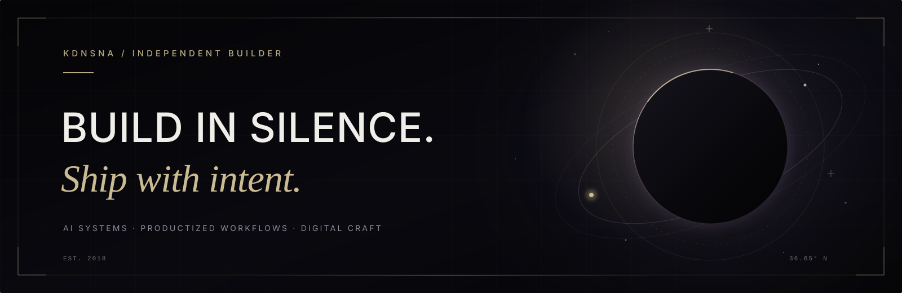

  

   
  <strong>让 AI 不止于生成，而是抵达交付。</strong>
   
  Between generation and delivery — building quiet systems for work that matters.
    
  <a href="https://kdnsna.cn">WEBSITE</a>
  &nbsp;·&nbsp;
  <a href="#01--selected-work">SELECTED WORK</a>
  &nbsp;·&nbsp;
  <a href="#03--instruments">INSTRUMENTS</a>

 

## 01 / Selected Work

<table>
  <tr>
    <td width="30%"><strong><a href="https://github.com/kdnsna/ultimate-ppt-master-skill">Ultimate PPT Master</a></strong></td>
    <td>从一句话到可编辑、可审阅、可交付的 PPTX / Web Deck。</td>
    <td width="18%"><code>Python · Web</code></td>
  </tr>
  <tr>
    <td><strong><a href="https://github.com/kdnsna/WeChatPilot">WeChatPilot</a></strong></td>
    <td>Local-first、可审计的微信自动化，把重复工作安静地交给系统。</td>
    <td><code>TypeScript</code></td>
  </tr>
  <tr>
    <td><strong><a href="https://github.com/kdnsna/pptlint">PPTLint</a></strong></td>
    <td>演示文稿交付前检查：链接、引用、残留与修改后复检。</td>
    <td><code>Python · CI</code></td>
  </tr>
  <tr>
    <td><strong><a href="https://github.com/kdnsna/localscan">LocalScan</a></strong></td>
    <td>本地优先的 iPhone 文档扫描，让矫正与 AI 处理留在设备上。</td>
    <td><code>Swift</code></td>
  </tr>
  <tr>
    <td><strong><a href="https://github.com/kdnsna/novelripple">NovelRipple</a></strong></td>
    <td>分支叙事与互动小说创作平台，让一个选择荡开整个世界。</td>
    <td><code>TypeScript</code></td>
  </tr>
</table>

## 02 / In the Dark

> **NarrativeOS** — 为中文长文与长篇小说作者构建的创作工作台。  
> 把上下文、证据与版本，组织成一座可以来回穿梭的图书馆。

Currently building in private. Some things are better revealed when they are ready.

### Principles

| LOCAL-FIRST | EDITABLE BY DESIGN | EVIDENCE OVER CONFIDENCE | COMPLETE LOOPS |
| :--- | :--- | :--- | :--- |
| 源文件与交付物，优先留在用户可控的环境。 | 不只展示结果，每个成果都应该能继续修改。 | 用渲染、测试与发布记录说明「为什么可以交」。 | 再小的工具，也要有入口、边界、诊断与交接。 |

## 03 / Instruments

<code>TypeScript</code> &nbsp; <code>Python</code> &nbsp; <code>Vue</code> &nbsp; <code>Swift</code> &nbsp; <code>Node.js</code> &nbsp; <code>PostgreSQL</code> &nbsp; <code>GitHub Actions</code> &nbsp; <code>MCP</code>

  
<strong>04 / Signals from the dark</strong>

   
  

    
    
  

 

  JINAN, CHINA &nbsp;·&nbsp; BUILDING QUIETLY, SHIPPING DELIBERATELY.
    
  <a href="https://kdnsna.cn">kdnsna.cn</a>
  &nbsp;·&nbsp;
  <a href="https://github.com/kdnsna">GitHub</a>
    
  

